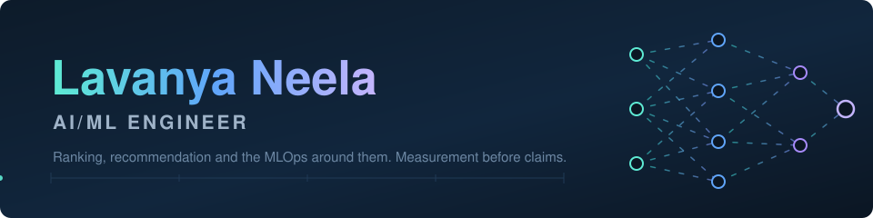

<p align="center">
  
</p>

<p align="center">
  
  
  <a href="https://github.com/lavanyaneela?tab=repositories"></a>
</p>

<table width="100%">
  <tr>
      <td align="center" width="20%"><div style="font-size:24px">🧭</div><b style="font-size:22px">5+</b><br/><sub><b>YEARS IN ML</b></sub></td>
      <td align="center" width="20%"><div style="font-size:24px">🚀</div><b style="font-size:22px">10+</b><br/><sub><b>PRODUCTION MODELS</b></sub></td>
      <td align="center" width="20%"><div style="font-size:24px">✅</div><b style="font-size:22px">TOTAL_TESTS_PENDING</b><br/><sub><b>TESTS IN OPEN WORK</b></sub></td>
      <td align="center" width="20%"><div style="font-size:24px">📐</div><b style="font-size:22px">35</b><br/><sub><b>DECISION RECORDS</b></sub></td>
      <td align="center" width="20%"><div style="font-size:24px">🗄️</div><b style="font-size:22px">5</b><br/><sub><b>SQL DIALECTS</b></sub></td>
  </tr>
</table>

> I build ranking and recommendation systems for a living, and what I care about most is whether the numbers around them mean what they claim. An offline metric and the production truth diverge in quiet ways: evaluation that cannot see its own bias, monitors that go blind while labels are in flight, feature pipelines that borrow from the future. My open work below measures those gaps, and every figure in it is reproduced by one command, `make verify`, from a fresh clone, offline.

## The pivot point

```text
Jun 2020                  Jul 2023    Aug 2023                  Dec 2025
   |----- IBM, India -----|           |----- NIU, Illinois -----|
   enterprise ML generalist              master's (the bridge)
                                          Jul 2024 ----------------->
                                             Meta, USA: ranking and
                                             personalization at scale
```

Three years at IBM meant breadth: forecasting, anomaly detection, document NLP, fifteen plus enterprise use cases, and the lifecycle plumbing (MLflow, OpenShift, Jenkins) that keeps them alive. The master's at Northern Illinois University was the deliberate bridge to the US market, and the Meta role that began during it is the depth the breadth was pointed at: prediction, ranking and recommendation for personalization, the territory most of my open work comes from.

## Current focus

| 🏢 At work | 🔭 In the open |
| --- | --- |
| Ranking and recommendation models for personalization at Meta: behavioral signals, embeddings, Transformer and LLM features | Tools for ML evaluation and operations, each one measuring a failure the standard tooling reports as success |
| MLOps for 10+ production models: MLflow, Docker, Kubernetes, CI/CD, drift and latency monitoring | Offline-reproducible engineering: committed fixtures, seeded generators, receipts mechanisms that fail the build when prose and measurement drift apart |
| Real-time inference services in FastAPI, latency work from ~180ms to ~140ms | SQL depth across 5 dialects, from window-function suites on real Postgres to a four-dialect feature compiler |

## Stack, by depth

The yardstick for every level: **could I debug this in production at 3am, or have I only shipped with it?** Self-assessed against that question, with the evidence named.

| | Depth | Level | Evidence |
| --- | --- | --- | --- |
| Python | `██████████` | debug at 3am | Five years across IBM and Meta; every repository below, TOTAL_TESTS_PENDING tests between them |
| SQL | `█████████░` | debug at 3am | A feature/audit spec compiled to 28 files across four dialects in `point-in-time-audit`; window-function suites executed row for row on real Postgres 16 in CI |
| PyTorch / TensorFlow / Keras | `████████░░` | ship and tune | Daily modeling at Meta; Keras 3 CNN and LSTM arms with bit-identical deterministic reruns in `finetune-eval-power` |
| MLOps (MLflow, registries, CI) | `████████░░` | ship and tune | Registries wired into `replay-gap` and `blind-window`; a receipts-gated CI pipeline in every repository, two already green on GitHub's own runners |
| Spark / PySpark | `███████░░░` | ship and tune | 5TB+ monthly feature pipelines at Meta; a Spark 4 engine as one half of the referee pair in `point-in-time-audit` |
| RAG tooling (LangChain, LangGraph, FAISS) | `███████░░░` | ship and tune | A traced LangGraph pipeline with measured attribution in `rag-stage-attribution`; exact FAISS over real MiniLM vectors in two repositories |
| Cloud inference (SageMaker, Vertex, Azure ML) | `██████░░░░` | shipped with, modeled offline | Billing mechanics, placement economics and generated Terraform in `inference-unit-economics`; no live deployment inside this portfolio, and that boundary is documented there |
| Terraform | `█████░░░░░` | read and generate | Real HCL generated, parsed back with python-hcl2 and coverage-mapped in `inference-unit-economics`; never planned or applied, and the repo says so |
| Kafka / Airflow | `█████░░░░░` | structural | A real DAG, DagBag-imported and analyzer-scanned, plus a Kafka-shaped log round-tripped through a real broker in `point-in-time-audit`; scheduler and load behavior deliberately out of scope |

## Building blocks

<div align="Center">

<p>
  
  
  
  
  
  
  
  
  
</p>
<p>
  
  
  
  
  
  
  
  
  
  
  
</p>
<p>
  
  
  
  
  
  
  
  
</p>

</div>

## Open work

| Repository | Tests | Coverage | The measurement it produced |
| --- | --- | --- | --- |
| [`replay-gap`](https://github.com/lavanyaneela/replay-gap) | FILL_TESTS | FILL_COV | Naive replay reads **+5.53%** lift for the deployed ranker evaluated against its own log; the true lift is exactly **0.00%**. Across 180 sampled rankers it picks the wrong winner in **27.1%** of decisive cases, worst case a true **-10.80%** read as **+6.24%**. |
| [`semantic-cache-audit`](https://github.com/lavanyaneela/semantic-cache-audit) | FILL_TESTS | FILL_COV | On `all-MiniLM-L6-v2`, **0 of 120** true paraphrases can be served from cache without admitting at least one wrong answer, and the encoder's **77** most confident matches are all wrong. Direction reversal fails at **100.0%** and never scores below 0.989. |
| [`finetune-eval-power`](https://github.com/lavanyaneela/finetune-eval-power) | FILL_TESTS | FILL_COV | The suite's aggregate moved **-1.27 points** (it improved) and flagged **0 of 10** retrainings while **8 slices regressed** past its detection floor; the worst slice lost **10.58 points** with 120 cases on hand. Seed spread alone sets a **3.92 point** noise floor no suite size reduces. |
| [`inference-unit-economics`](https://github.com/lavanyaneela/inference-unit-economics) | 169 | 98.0% | The serverless-to-autoscaled flip sits at **9.2 rps on GCP and 280.9 on AWS**, 30.5x apart for the same measured model, so the crossover belongs to billing rules, not the model. Billed duration runs **93x** service time on SageMaker Serverless and **9,310x** on Cloud Run. |
| [`blind-window`](https://github.com/lavanyaneela/blind-window) | 150 | 98.5% | On the committed stream, a regression beginning day 30 is **blind for 20.5 days** and the model serves **16,261 predictions** before the operator's 2-point question becomes answerable. Worst-feature PSI correlates **-0.001** with realized accuracy loss. |
| [`rag-stage-attribution`](https://github.com/lavanyaneela/rag-stage-attribution) | 218 | 98.8% | Trace-based attribution recovers the true failing stage in **99.5% of 1,172** injected failures; remove the per-node trace and accuracy falls to **61.9%** with **0 of 360** retrieval-side failures placed. 80.8% of the failures that remain after a retrieval fix belong to the generator. |
| [`point-in-time-audit`](https://github.com/lavanyaneela/point-in-time-audit) | 239 | 98.7% | The fact-time-only pipeline, the one that passes code review, reads AUC **0.8913** where the honest point-in-time AUC is **0.7668**: **12.45 points fabricated**. The static gate catches **70.8%** of corpus leak cases and **100% of the 17 direct sites**, with its misses named by class. |

These share a working style rather than a theme. The uncomfortable number leads: each README opens with what the tool cannot do, or the case where the convenient method loses. Nothing numeric is typed by hand: a receipts mechanism re-measures every published figure on every `make verify` and fails the build when prose and measurement drift apart. And everything runs offline from committed fixtures and seeded generators, so a reviewer can reproduce any number without credentials, keys, or trust.

## Quick connect

<div align="Center">

[](mailto:lavanyaneela@mycvcareer.com)
[](https://www.linkedin.com/in/lavanyaneelaai/)
[](https://github.com/lavanyaneela)

</div>

